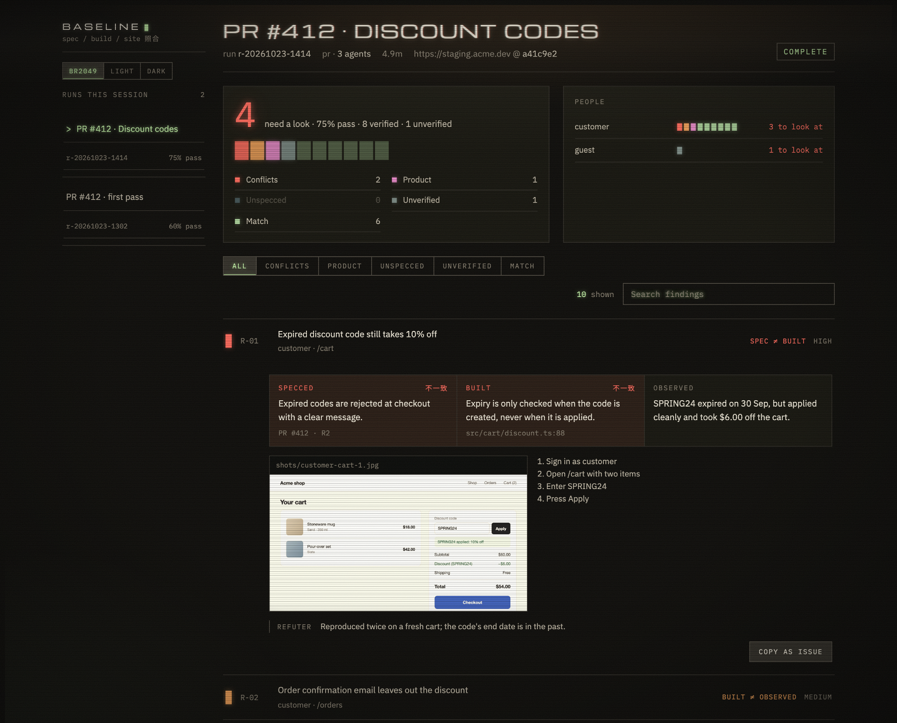
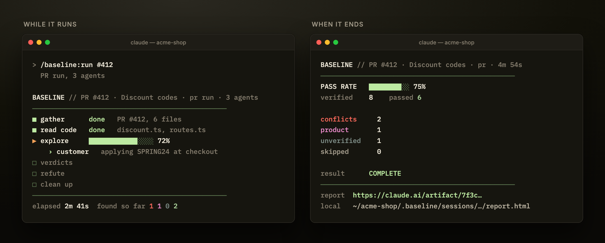
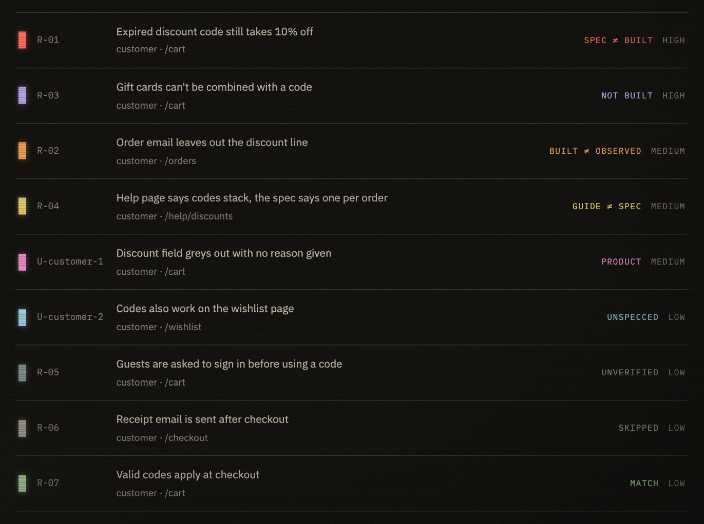
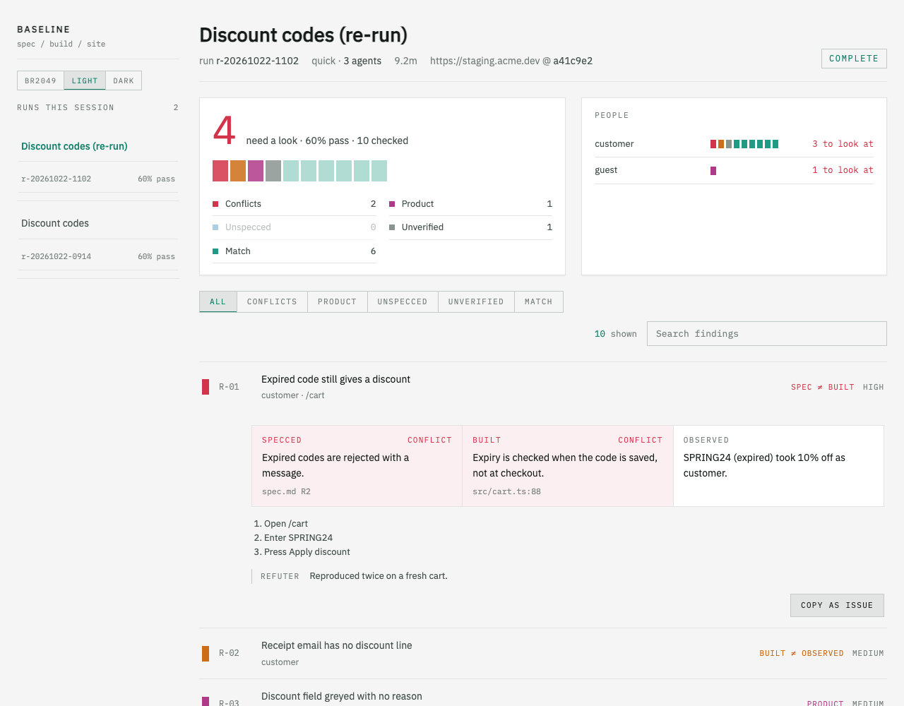
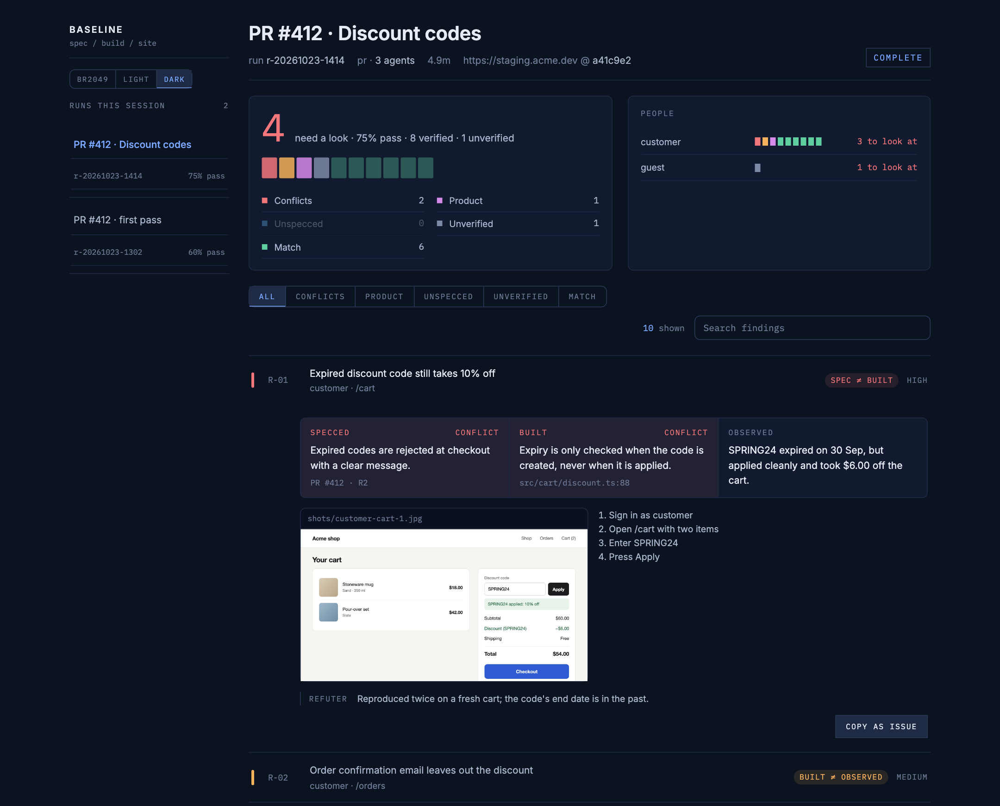

# Baseline

[](https://code.claude.com/docs/en/plugins)
[](LICENSE)

Acceptance testing for any web app, from inside Claude Code. Point it at a PR, ticket or spec and a
URL. It reads the code, walks the site as your test users, and reports where **the spec, the code
and the site** disagree, plus anything that works but would fail a QA engineer's eye.



Built for QA engineers, and for developers who want the easy QA issues caught before their change
reaches QA. Every finding is advisory: Baseline never passes or fails a change. You decide.

## Quick start

1. Install the plugin in Claude Code:

   ```text
   /plugin marketplace add Johnster02/Baseline
   /plugin install baseline@baseline
   ```

2. In the project you want to test, run setup once. It installs a browser (Playwright and
   Chromium, into the plugin's own data folder) and asks for your test accounts and what each may
   do. Re-run it any time.

   ```text
   /baseline:setup
   ```

3. Check something. Give it a PR, ticket or spec, then pick the URL to test when it asks:

   ```text
   /baseline:run #412
   ```

When it finishes you get a summary in the terminal and a link to the full report.

**Requirements:** Claude Code (logged in), Node 20 or later, and npm for the one-time browser
install. The live progress band needs Claude Code v2.1.287 or later. Publishing the report as a
claude.ai artifact needs a claude.ai login on Pro, Max, Team or Enterprise; otherwise the report is
a local HTML file. Tested with Claude Code 2.1.308.

## Usage

```text
/baseline:run #412                          # a PR
/baseline:run SHOP-12                       # a Jira or Linear ticket
/baseline:run docs/specs/discounts.md       # a spec file, a folder, or "pasted text"
```

Mix them to check a PR against its spec: `/baseline:run #412 docs/specs/discounts.md`.

Each run asks which URL to test (the last one is the default): staging, a preview deploy or
`http://localhost:3000`. Baseline reads the code that is checked out on your machine, so check out
the PR's branch first. If setup was given a way to read the site's version, a run warns when the
site is on a different commit.

Each run sizes itself and says so before it starts:

- **PR run** for one small PR (up to 15 changed files), about 5 minutes: a code reader, one
  explorer (two only when the change looks different for another role), a fast refuter. A PR that
  changes nothing a user can see is checked from the code alone.
- **Quick run** for a single bug, ticket or short spec, about 10 minutes: a code reader on the
  changed files, one or two explorers, a refuter.
- **Full run** for a feature with a spec or guide, 30 minutes or more: code reader, an explorer per
  persona, a guide reader, product checks, a refuter and clean-up.

Add `--pr`, `--quick` or `--full` to choose. `--live` is needed to test a URL you marked as production.

While it runs, a band above the prompt shows each phase and what every agent is doing. When it
ends you get totals only: pass rate, counts, `Complete`, and a link to the report (a private
claude.ai artifact if you chose that in setup, otherwise a local file).



### The report

One page per Claude Code session: run again after a fix and the new run joins the same page.
Findings are listed worst first, each with **Specced / Built / Observed** side by side, the steps
to reproduce, screenshots, and the refuter's note. "Copy as issue" turns one into a bug report.

Every finding gets one verdict:



| Verdict | Meaning |
|---|---|
| spec ≠ built | the code does something other than the spec |
| built ≠ observed | the code looks right but the site does something else |
| not built | nothing implements it |
| guide ≠ spec | the user guide promises something different |
| unspecced | the site does something the spec never mentions |
| product | works, but fails the [product checklist](checklists/product.md) |
| unverified | the code says yes, but the site never showed it |
| skipped | a permission stopped the check (see below) |
| match | spec, code and site agree |

Code is optional but recommended. Run inside the product's repository and you get all three
columns. Without the code, Baseline compares the spec with the site and says so.

**Low noise by design.** A finding must tie to the change or its screens, survive a refuter that
tries to disprove it, and carry evidence. Unrelated observations are collapsed and capped at five.
Duplicates across personas are merged. If something is deliberate, `/baseline:dismiss R-03 "why"`
and later runs leave it alone.

### Themes

BR2049 (default), Light, and a navy Dark, for both the report and the band:
`/baseline:theme dark`.

| Light | Dark |
|---|---|
|  |  |

## Safety

Baseline drives a real browser through someone's site, so it is careful by default.

- **Look only is the default** for every test account. A look-only runner can browse and read, and
  the browser layer blocks any request that would change data.
- **Protected areas are off unless you allow them**, per runner: live sites and real users, sending
  email, sign-in and accounts, deleting projects or users, payments and finance. Setup lets you
  name them on your site (URL patterns, button words) on top of the built-in ones.
- **Agents never assume.** Anything that looks protected is skipped and listed in the report with
  the permission that would allow it. At the end of a run you can choose to allow those for next
  time. Permissions only ever change with your answer in the terminal.
- **Production URLs are refused** unless you ask for a live run.
- **Agents never touch the browser directly.** Their scripts talk to a browser held by Baseline
  through a short list of commands (go to, click, fill, read, screenshot). A Bash hook also blocks
  HTTP writes to the site and direct Playwright use while a run is active.
- **Test account passwords** are typed into a one-time form in your browser, so Claude never
  sees them. They're saved on your machine only, in a file only your user can read, outside your
  project, and never in logs or reports. The file isn't encrypted, so use test accounts, not real
  ones. Each teammate runs setup with their own. Accounts behind SSO or MFA are signed in by hand
  once and that login is reused; when a saved login expires, the run says so and you sign in again
  with setup.
- **Anything a run creates is tidied up.** Only runners you allow to create things can, and
  everything they make is named `Baseline <run id> …`. A clean-up agent removes it at the end, and
  anything it could not remove is listed in the report.
- **Nothing changes mid-run.** While a run is active, agents can't change permissions, runners or
  production settings, and browser tools other than Baseline's own are switched off.

**The honest limit:** blocking every write for look-only runners is enforced in code. Spotting a
protected action on a site Baseline has never seen (that a button sends an email, say) is best
effort, from the patterns you give it plus agents told to skip anything doubtful. The guard is
built to stop accidents by a well-meaning agent, not a deliberately hostile script. Use test
accounts on a test site. More in [docs/permissions.md](docs/permissions.md).

## Where things go

| What | Where |
|---|---|
| Project settings, runs, reports, site map, notes | `.baseline/` in your project (setup adds it to `.gitignore`) |
| Test account passwords, saved logins, the browser | the plugin's data folder (`~/.claude/plugins/data/…`), on your machine only |
| Jira and Linear tokens | `/plugin configure baseline`, stored in your system's secure store |

## Develop

```bash
pnpm install
pnpm check          # types, unit tests, dist up to date, mod tests
pnpm fixture        # the "Acme shop" test site
claude --plugin-dir .
```

`dist/` and `mod/` are built and committed, so installing the plugin needs no build step. See
[CONTRIBUTING.md](CONTRIBUTING.md).

## Licence

[MIT](LICENSE)
